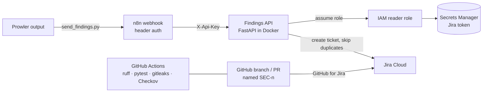
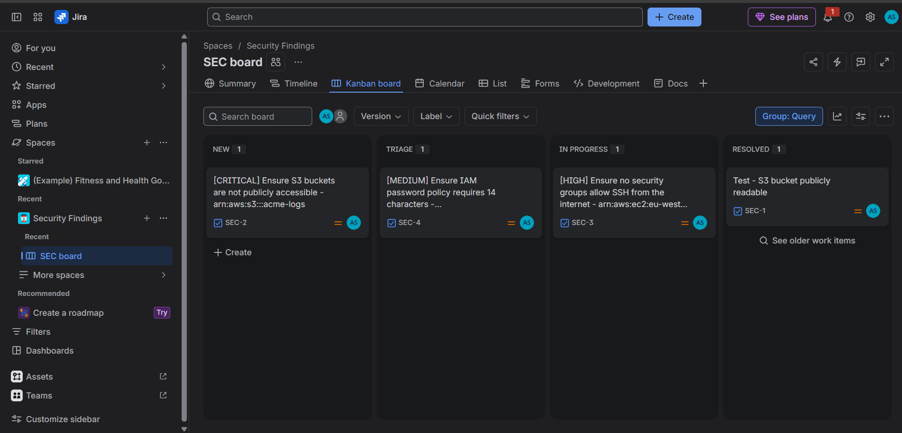
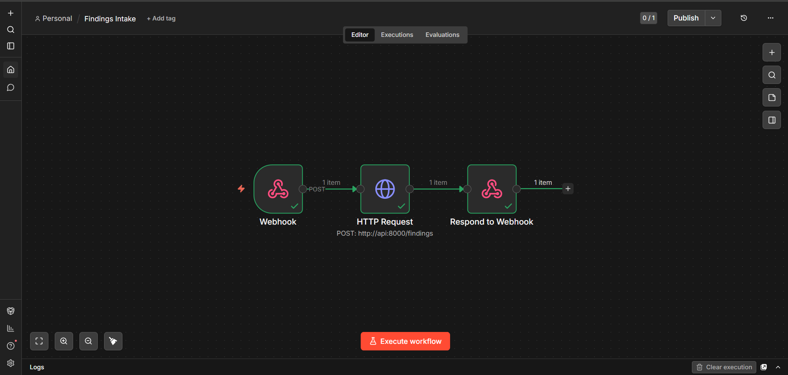
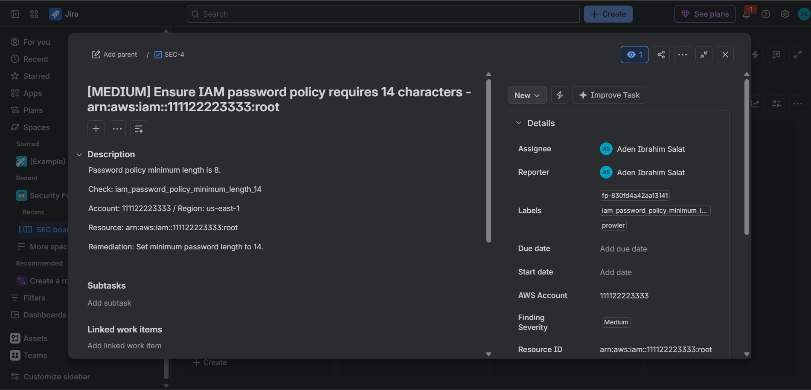
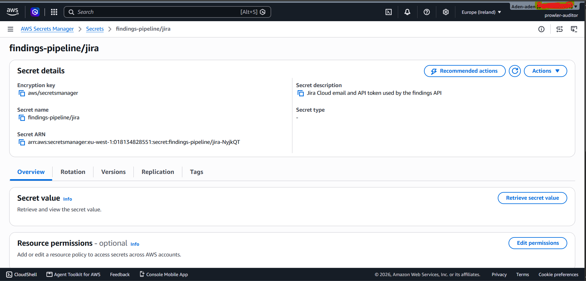
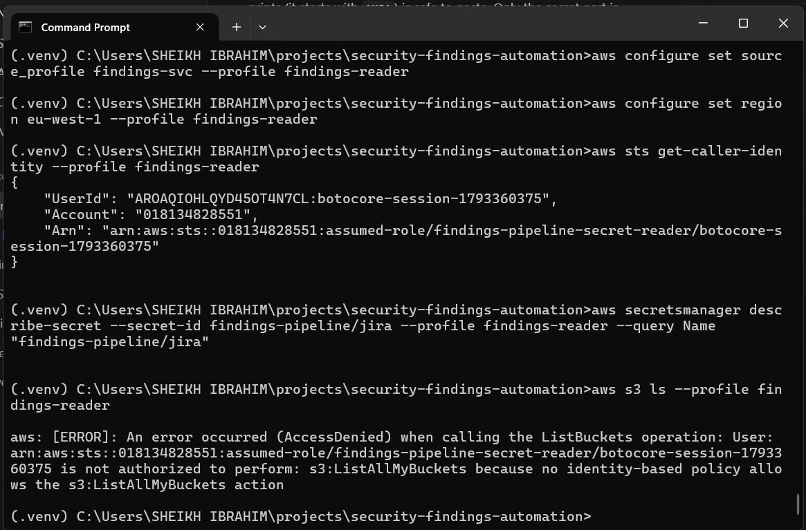
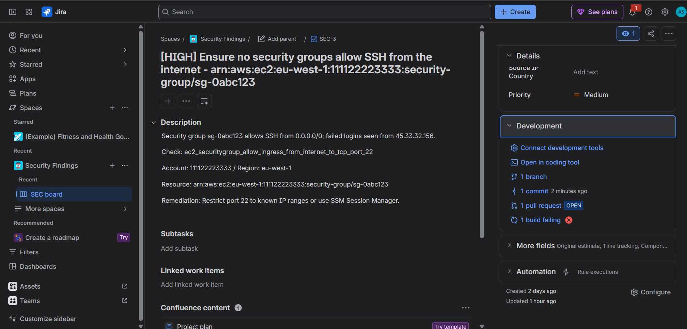
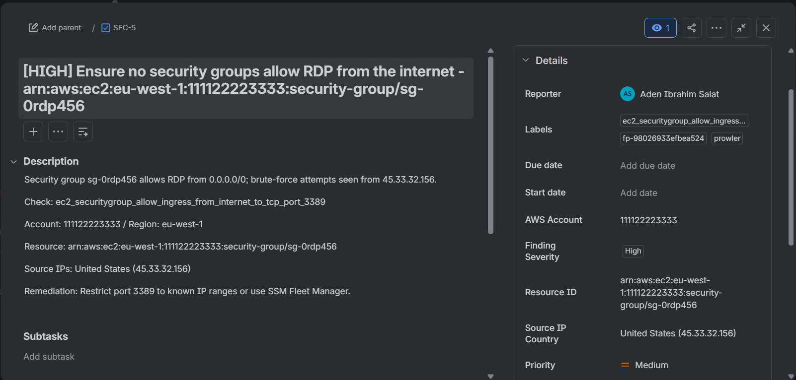
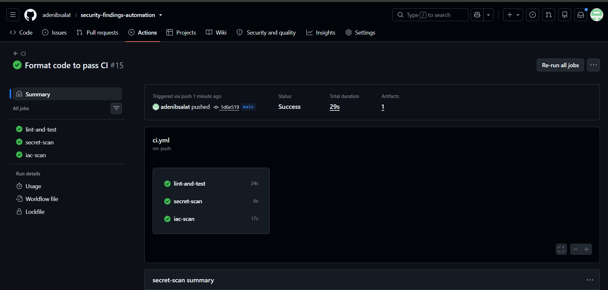

# Security Findings → Jira Automation


Event-driven pipeline that turns **Prowler** AWS findings into **enriched Jira tickets**
(severity validation, auto-assignment, GeoIP), linked to **GitHub PRs**, with the Jira
token held in **AWS Secrets Manager** behind a least-privilege IAM role.

## Architecture



1. `send_findings.py` posts a Prowler file (json-ocsf or v3) to the **n8n webhook**, which rejects requests without the webhook key.
2. n8n forwards the findings to the **Findings API**, using a separate API key, so one leaked key doesn't open everything.
3. The API keeps **FAIL** findings at or above the chosen severity, removes duplicates by fingerprint, and looks up the **country** of any public IP.
4. It reads the Jira token from **Secrets Manager**, assuming a role that can read **only that one secret**, and creates the ticket. A ticket that already exists (matched by the label `fp-<fingerprint>`) is skipped, so retries are safe.
5. In Jira, a **validator** blocks tickets without a Finding Severity, and a **post-function** auto-assigns them.
6. Branches, commits and PRs containing the ticket key (for example `SEC-3-ssh-runbook`) appear on the ticket.

## Security decisions

| Decision | Why |
|---|---|
| Jira token only in Secrets Manager, never in `.env` or Terraform state | Terraform state stores values in plain text |
| `findings-pipeline-svc` user can only `sts:AssumeRole` one role; the role can only read one secret | A leaked key exposes one secret, nothing else (verified: `s3 ls` → AccessDenied) |
| Container gets its own `.aws-findings` folder, mounted read-only | Admin credentials never enter Docker |
| Two keys (webhook, API), compared with `hmac.compare_digest` | Defence in depth; resistant to timing attacks |
| n8n and the API bound to `127.0.0.1`; API runs as non-root | Nothing is exposed to the network |
| n8n image pinned (2.17.8) | Reproducible builds |
| gitleaks scans the full Git history in CI; Checkov scans Terraform | Catches leaked secrets and misconfigurations before merge |
| Checkov skips are documented inline | Accepted risks are deliberate and explained |

## Screenshots

| | |
|---|---|
| Jira board |  |
| n8n workflow |  |
| Ticket created by the pipeline |  |
| Secrets Manager |  |
| Least privilege: AccessDenied |  |
| GitHub ↔ Jira development panel |  |
| GeoIP country on ticket |  |
| CI green |  |

## Run it

```
python -m venv .venv && .venv\Scripts\activate
pip install -r requirements-dev.txt && pip install -e .
pytest -q

cd terraform && terraform init && terraform apply && cd ..
copy .env.example .env          # fill in values
docker compose up -d --build    # n8n on :5678, API on :8001
python scripts\send_findings.py <prowler.json> --url http://localhost:5678/webhook/prowler-findings --key-env N8N_WEBHOOK_KEY
```

GeoIP uses a GeoLite2-format database (DB-IP Lite) at `data/geoip-country.mmdb`. It isn't committed to the repo.
If something breaks, see the [runbook](docs/runbook.md).

## Stack
Python 3.11 · FastAPI · n8n · Docker Compose · Jira Cloud REST API · GitHub for Jira ·
AWS Secrets Manager & IAM · Terraform · GitHub Actions · gitleaks · Checkov · Prowler